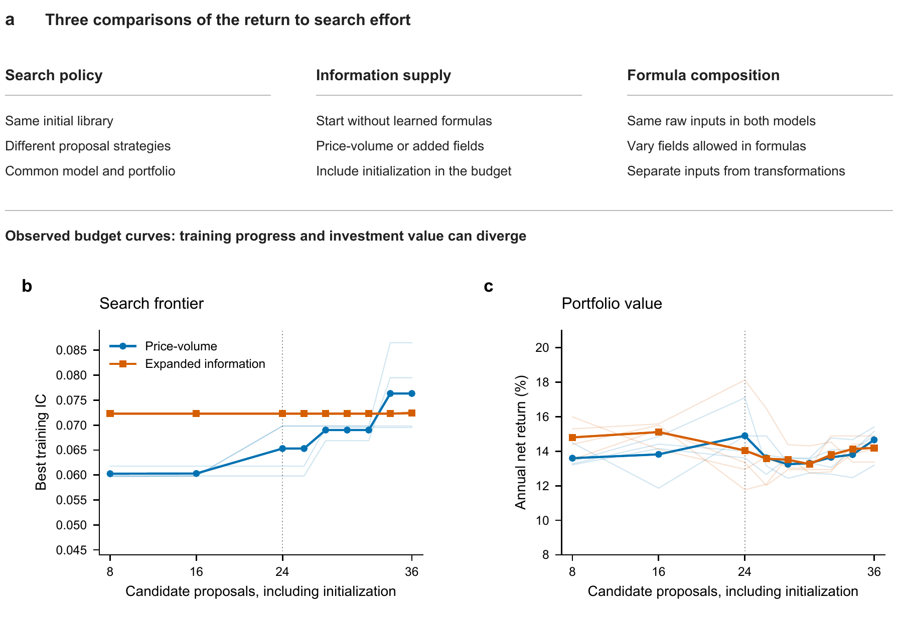
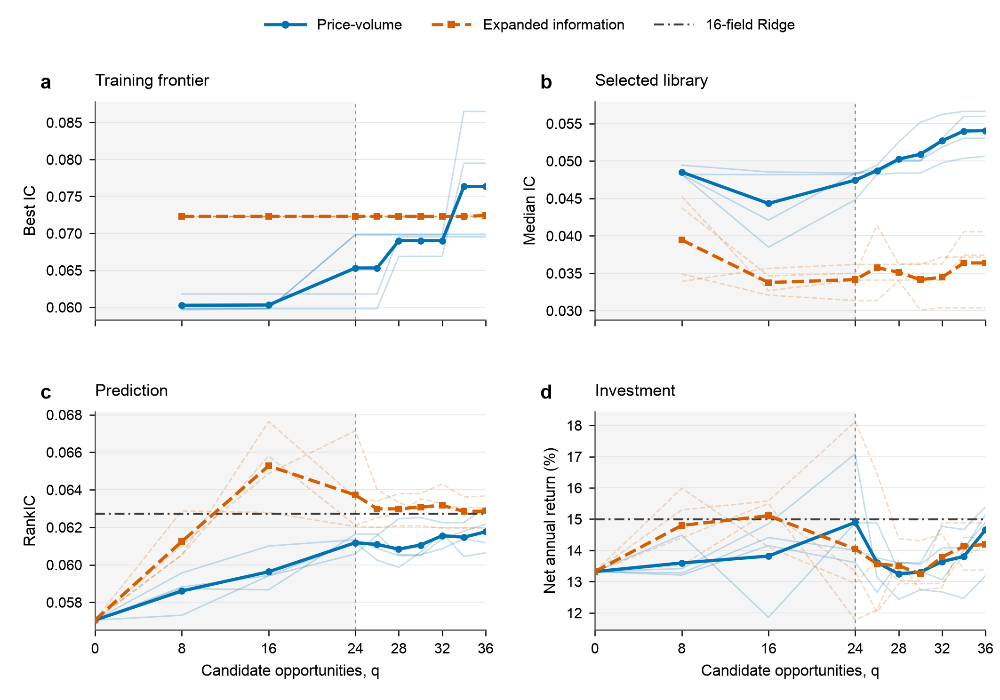

# StableAlpha

**How much of the gain from LLM-guided alpha search actually reaches an investor's portfolio?**

[](https://doi.org/10.5281/zenodo.23379471)

[](LICENSE)

## Research question

Large language models can propose stock-return factors without limit, so the useful question is no longer
whether they can find a formula with a good backtest score, but what one *additional* proposal, or one
*additional* data source, is worth for an investment decision. StableAlpha measures the **marginal yield of
search**: it follows extra search effort through three stages (the training score the search optimizes, the
accuracy of a joint return forecast, and the net return of a long-only portfolio after trading costs) on
China Securities Index 500 (CSI500) A-shares. Treating research effort as a scarce input, the project asks
which next investment pays: another proposal, better information, or a better selection objective.

## Key findings

From the paper *The Marginal Yield of LLM-Guided Alpha Search* (CSI500; main experiments fit on 2010–2019 and
evaluate on 2020–2022; Alpha158 + 16 learned factors, Ridge predictor, equal-weight top-decile portfolio,
2 bp per side):

- **Search gains do not transmit to returns.** In discovery from scratch, twelve further price-volume
  proposals raise the best training IC from 0.0653 to 0.0763 (**+16.9%**), while mean annual net return
  changes by **−0.24 percentage points** (14.90% → 14.66%).
- **Repairing formula defects improves factors but weakens joint prediction.** Repair-directed search lifts
  the library's median member IC by 0.0060 (95% CI [0.0028, 0.0091]) while the joint model's RankIC *falls*
  by 0.0006 (95% CI [−0.0009, −0.0003]); its return is equivalent to mixed-operator search within ±0.5 pp a
  year (TOST p = 0.015).
- **Information is worth more than search over it.** An expanded 227-field dictionary speeds early
  discovery, but a Ridge model given 16 training-selected raw fields directly is not outperformed by the searched
  libraries (RankIC 0.0627, net return 15.0%) and needs no generation calls; expanded search spends 2.86× the tokens of
  price-volume search.
- **Composition still carries information.** When both predictors already receive the same 25 raw fields,
  formulas composed from them keep a small, significant forecasting edge (RankIC +0.0010, HAC 95% CI
  [0.0002, 0.0018], adjusted p = 0.021) with a portfolio effect bounded within one percentage point a year.
- **The lesson for research allocation:** factor-search effort is best judged by the return it delivers,
  not by the score it optimizes.



## Approach

The framework builds on **CogAlpha** (Liu et al., 2026), a seven-level, 21-role LLM factor-mining architecture
with evolutionary search. StableAlpha re-implements that topology as auditable research software and adds
what an investment-grade evaluation needs: a **safe, typed factor DSL** (JSON ASTs with a 48-node limit,
canonical semantic hashing, price-scale and time-series/cross-sectional stage typing, lookback inference and
point-in-time evaluation, so the LLM can never inject arbitrary code); **exact search-budget accounting**
in which invalid and duplicate proposals still consume an opportunity; typed mutation and crossover with
anti-bloat rules and an equal-weight parent control for every child; a feedback controller that only sees
allowlisted train/inner-validation statistics; **strict validation** (purged train/validation/test splits,
HAC and moving-block bootstrap inference, Holm/max-T multiplicity control, and a one-time sealed-test
registry with a tamper-evident trial ledger); and a **cost-aware A-share execution simulator** (fees and
stamp duty, board lots, T+1, price limits, suspensions, participation caps) feeding a convex long-only
optimizer whose solutions are re-audited against every constraint.

```mermaid
flowchart LR
    D["Point-in-time A-share panel<br/>(dated index membership)"] --> C["LLM factor cards<br/>(21 roles, typed DSL)"]
    C --> G["Static gates: AST safety,<br/>lookahead, dedup"]
    G --> E["Evolutionary search<br/>(mutation, crossover, repair)<br/>exact budget accounting"]
    E --> V["Train / inner-validation scoring<br/>IC, RankIC, HAC, turnover"]
    V -->|sanitized feedback| E
    V --> L["Factor library<br/>+ trial ledger"]
    L --> M["Joint predictor<br/>(Alpha158 base + factors; Ridge / LightGBM)"]
    M --> P["Top-decile portfolio,<br/>costs, A-share execution"]
    P --> R["Paired budget curves:<br/>score → forecast → net return"]
```





## Repository layout

| Path | Contents |
|---|---|
| `src/cogalpha_plus/dsl.py` | Safe factor DSL: typed AST, canonical hashing, point-in-time evaluator |
| `src/cogalpha_plus/evolution.py` | 21-role evolutionary search, typed mutation/crossover, feedback controller, injection |
| `src/cogalpha_plus/validation.py`, `metrics.py` | Purged splits, IC/RankIC, HAC, block bootstrap, multiplicity control |
| `src/cogalpha_plus/registry.py`, `manifest.py` | Content-addressed factor registry, run manifests, hash-chained trial ledger |
| `src/cogalpha_plus/portfolio.py`, `execution.py`, `backtest.py` | Convex constrained optimizer, A-share cost/execution simulator, event backtest |
| `src/cogalpha_plus/track_a*.py`, `hs300_research.py` | End-to-end research protocols (development search, frozen one-time reveal) |
| `src/cogalpha_plus/data_sources/` | BaoStock point-in-time adapter, panel build and independent data audit |
| `configs/` | 21-role agent catalog, faithful/Plus search profiles, data contract, protocols |
| `proposals/` | Frozen LLM-authored factor cards (80 seed + 96 repair cards) |
| `scripts/` | Entry points: search, one-time reveal, smoke test, data pipeline, portfolio replay |
| `tests/` | 40+ test modules (synthetic fixtures; no vendor data needed) |
| `paper/` | Paper PDF and a self-contained figure-reproduction package |
| `docs/` | Configuration, LLM workflow and data-pipeline notes |

## Reproducing

```bash
python -m venv .venv && source .venv/bin/activate
pip install -e ".[dev]"
pytest -q                                              # full suite, ~3 min, no market data needed
stablealpha check-config --project .                   # validate roles, factor cards, budgets
stablealpha demo --output runs/demo --budget tiny --reveal-synthetic-sealed   # synthetic end-to-end run
```

Regenerate the paper figures from the saved result tables (no data or model calls required):

```bash
pip install -r paper/figure_reproduction/requirements.txt
python paper/figure_reproduction/run_all.py
```

**Data.** Tushare and BaoStock market data are licensed by their providers and are **not redistributed**.
Install `pip install -e ".[data-baostock]"`, then build a point-in-time panel with
`stablealpha data membership | prices | industry | build | audit` (see `docs/data_baostock_hs300.md`).
All data paths resolve under `./data` or under `$STABLEALPHA_DATA_HOME` (see `.env.example`), e.g.
`$STABLEALPHA_DATA_HOME/baostock_hs300/{raw,normalized,panel}`. Any provider export (including a Tushare
CSI500 panel) can be used once it passes the fail-closed contract in `configs/data_contract_a_share.yaml`.

## Paper

**The Marginal Yield of LLM-Guided Alpha Search: Search Effort, Information and Investment Value.**
Siyan Chen, 2026. Zenodo preprint, CC BY 4.0. DOI
[10.5281/zenodo.23379471](https://doi.org/10.5281/zenodo.23379471) ·
PDF: [`paper/marginal_yield_llm_alpha_search.pdf`](paper/marginal_yield_llm_alpha_search.pdf)

## Citation

```bibtex
@misc{chen2026marginal,
  author    = {Chen, Siyan},
  title     = {The Marginal Yield of {LLM}-Guided Alpha Search: Search Effort, Information and Investment Value},
  year      = {2026},
  publisher = {Zenodo},
  doi       = {10.5281/zenodo.23379471},
  url       = {https://doi.org/10.5281/zenodo.23379471}
}
```

This project builds on CogAlpha:
Fengyuan Liu, Yi Huang, Sichun Luo, Yuqi Wang, Yazheng Yang, Xinye Li, Zefa Hu, Junlan Feng and Qi Liu (2026).
*Cognitive Alpha Mining via LLM-Driven Code-Based Evolution.* Proceedings of the 64th Annual Meeting of the
ACL (Long Papers), 11715–11749. [doi:10.18653/v1/2026.acl-long.538](https://doi.org/10.18653/v1/2026.acl-long.538)

## Author

Siyan Chen · University of California, Santa Barbara · siyan_chen@ucsb.edu
